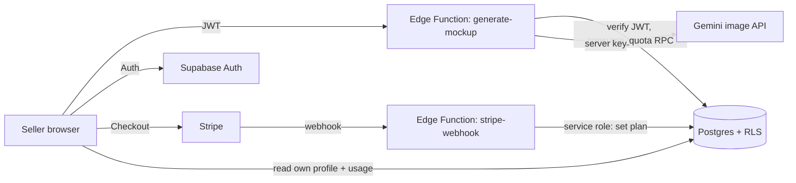

# Architecture

## Today (prototype)
Browser only: Vite + TypeScript app calls Gemini directly with an API key, stores everything in localStorage. Fine for a demo, **unsafe to deploy** because the key ships in the bundle.

## Target

## Components
| Component | Role |
|---|---|
| Vite SPA (Vercel) | UI, no secrets |
| Supabase Auth | Email + Google login, JWT |
| Postgres | `profiles`, `usage`, RLS select-only |
| `generate-mockup` Edge Function | Auth check, atomic quota, call Gemini, return image |
| `create-checkout` / `create-portal` | Stripe Checkout and Customer Portal sessions |
| `stripe-webhook` | Verified, idempotent; maps price ID to plan |
| Stripe | Subscriptions, tax, invoices |

## Generate flow
1. Client sends design + options with the user JWT.
2. Function verifies JWT, reads plan, computes the limit.
3. `consume_quota` increments usage atomically; reject if over limit.
4. Function calls Gemini; on failure, refund the quota.
5. Return the image; client stores it in the gallery.

## Subscribe flow
1. Client asks `create-checkout` for a session (customer resolved from JWT).
2. Stripe hosts payment. Webhook receives `checkout.session.completed` and `customer.subscription.*`.
3. Webhook verifies the signature, maps price ID to plan, updates `profiles` with the service role.
